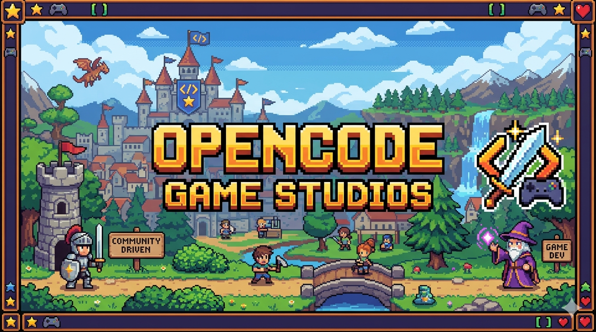

# OpenCode Game Studios

<p align="center">
  
</p>

> ⚡ Evolved from [Claude Code Game Studios (CCGS)](https://github.com/Donchitos/Claude-Code-Game-Studios) — now a standalone framework supporting [OpenCode](https://opencode.ai), [Pi](https://github.com/earendil-works/pi-coding-agent), [oh-my-pi](https://omp.sh/), [Claude Code](https://code.claude.com/docs/), and [Codex](https://developers.openai.com/codex/) coding agents.

[](LICENSE)
[](.agents/agents/)
[](.agents/skills/)
[](.agents/commands/)
[](.opencode/plugins/)
[](tests/)
[](https://opencode.ai)
[](https://github.com/earendil-works/pi-coding-agent)
[](https://omp.sh/)

---

## 📑 Table of Contents

- [💡 Motivation](#-motivation)
- [📊 Port Status](#-port-status)
- [🚀 Quick Start](#-quick-start)
- [🔌 Recommended Plugins](#-recommended-plugins)
- [🗺️ Key Mappings](#️-key-mappings)
- [📁 Directory Tree](#-directory-tree)
- [🔌 Plugin Architecture](#-plugin-architecture)
- [🏗️ Studio Hierarchy](#️-studio-hierarchy)
- [🐛 Known Issues](#-known-issues)
- [📄 License](#-license)

---

## 💡 Motivation

Game development is a multi-disciplinary process — design, writing, architecture,
programming, art, audio, QA, release — that's hard to coordinate with AI assistants
in ad-hoc chat sessions. **OpenCode Game Studios** provides a structured framework
for the full game lifecycle:

- **Pre-workflow exploration** — Rapidly prototype 2-4 ideas with zero commitment
  before choosing a development workflow
- **Design-first pipeline** — Brainstorm → systems map → section-by-section GDDs →
  cross-GDD review, before any code is written
- **Phase gates** — Formal checkpoints between phases with PASS/CONCERNS/FAIL
  verdicts that prevent advancing with gaps
- **Workflow selection** — Choose Hybrid (lightweight discovery then production)
  or Full OCGS (process-heavy from day one), depending on team size and project
  maturity
- **52 coordinated agents** — From creative director to engine specialists, each
  with defined responsibilities, delegation maps, and strict domain boundaries
- **78 slash commands** — Route through the right skill every time, from
  `/concept-brainstorm` to `/launch-checklist`

This project evolved from [CCGS](https://github.com/Donchitos/Claude-Code-Game-Studios)
and runs on [OpenCode](https://opencode.ai), [Pi](https://github.com/earendil-works/pi-coding-agent)
and [oh-my-pi](https://omp.sh/).

---

> ⚠️ **Active Development** — This is a living framework. Things will
> break, change, and improve. Report bugs at
> [github.com/striderZA/OpenCodeGameStudios/issues](https://github.com/striderZA/OpenCodeGameStudios/issues).

---

## 📊 Port Status

| Component | CCGS (Claude Code) | OpenCode | Pi | omp | Status |
|-----------|-------------------|----------|-----|-----|--------|
| 🤖 **Agents** | 49 agents (`.claude/agents/`) | 52 agents (`.agents/agents/`) | 52 agents (`.agents/agents/`) | Generated into `.omp/agents/` by the installer | ✅ |
| ⌨️ **Skills** | 72 skills (`.claude/skills/`) | 78 skills (`.agents/skills/`) | 78 skills (`.agents/skills/`) | 78 skills (`/skill:<name>`) | ✅ +6 |
| ⌨️ **Commands** | — | 78 commands (`.agents/commands/`) | → prompt templates | → slash commands | ✅ New |
| 🔗 **Plugins** | 12 bash hooks (`.claude/hooks/`) | 3 TS plugins (`.opencode/plugins/`) | 9 Pi extensions (`.pi/extensions/`) | 8 shared via config | ✅ **177 plugin + 54 hook tests** |
| 📏 **Rules** | 11 rule files (`.claude/rules/`) | 11 rule files (`.agents/rules/`) | 11 rule files (`.agents/rules/`) | 11 rule files (`.agents/rules/`) | ✅ |
| ⚙️ **Config** | `CLAUDE.md` + `.claude/settings.json` | `AGENTS.md` + `opencode.json` | `AGENTS.md` + `.pi/settings.json` | `AGENTS.md` + `.omp/config.yml` | ✅ |

---

## 🚀 Quick Start

### OpenCode
```bash
opencode
```
> **Windows users:** `.opencode/{agents,commands,skills,rules}` are git symlinks and require `core.symlinks=true` (+ Developer Mode) to check out correctly — see [Known Issues](#-known-issues) if `/` shows no commands.

Type `/` to browse all 78 skills and 78 commands, or `/start` for onboarding.

### Pi
```bash
pi
```
All OCGS skills and commands load automatically through Pi extensions. Pi has no
subagent tool; the `ocgs-tool-map` extension tells agents to do the work directly
when a workflow names `Task`. See
[docs/pi-compatibility.md#delegation](docs/pi-compatibility.md#delegation).

### oh-my-pi (omp)
```bash
omp
```
omp reads `.agents/` skills, commands, and rules natively and loads the shared Pi extensions through `.omp/config.yml`. Its task tool reads project agents from `.omp/agents/`; run `/init-template --harness omp` (or `add core --harness omp`) to generate them from `.agents/agents/`.
See [docs/omp-compatibility.md](docs/omp-compatibility.md) for setup details and known gaps.

### Claude Code
```bash
claude
```
Claude Code reads `AGENTS.md` natively and `.claude/rules/` with `paths` frontmatter. Run `/init-template --harness claude` (or `add core --harness claude`) to install agents, skills, and commands into `.claude/`; agent files gain the required `name:` frontmatter. Project MCP servers live in `.mcp.json` and need approval in an interactive session.

### Codex
```bash
codex
```
Codex reads `.agents/skills` and `AGENTS.md` natively. Run `/init-template --harness codex` (or `add core --harness codex`) to generate `.codex/agents/*.toml`. Codex has no project-level slash commands and no path-scoped rule equivalent; its MCP entries live in `.codex/config.toml` and load only in trusted projects.

### 🎮 Demo Game

See [**OCGS-Pong**](https://github.com/striderZA/OCGS-Pong) — a complete Pong game built entirely with this toolchain. Demonstrates the full workflow from concept through implementation using OCGS agents and skills.

---

## 🧩 Modular Framework

The framework is partitioned into **22 pluggable theme modules**. Only install what you need for your project:

| Module | Description |
|--------|-------------|
| `core` | Framework skeleton — directors, onboarding, `/start`, `/help` (required) |
| `art` | Aseprite MCP, art bible, asset specs, art generation |
| `design` | Game mechanics, systems design, combat, balance, playtesting |
| `architecture` | Technical planning, ADRs, architecture review |
| `stories` | Epics, stories, dev workflow, code review |
| `programming` | Gameplay, AI, engine, network agents + coding rules |
| `ui` | UX design, UI programming, accessibility |
| `audio` | Audio direction, sound design |
| `narrative` | Story, world-building, dialogue |
| `level-design` | Level layout, encounter design |
| `qa` | Testing strategy, bug tracking, profiling, skill testing |
| `release` | Release management, sprints, changelogs, hotfixes |
| `prototyping` | Rapid prototyping, concept exploration |
| `live-ops` | Post-launch content, community management |
| `localization` | i18n, translation pipeline |
| `engine-godot` | Godot 4 specialists (GDScript, C#, shaders, GDExtension) |
| `engine-unity` | Unity specialists (DOTS, shaders, Addressables, UI) + Unity CLI |
| `engine-unreal` | Unreal Engine 5 specialists (GAS, Blueprint, replication, UMG) |
| `engine-sfml3` | SFML 3 specialist (Graphics, Audio, Network, Window, System) |
| `engine-raylib` | Raylib specialist (core, rlgl, raudio, raymath, raygui) |
| `engine-bevy` | Bevy specialist (ECS, 2D/3D rendering, bevy_ui, assets, audio) |
| `data` | Data file conventions and validation |

```bash
# Install modules (OpenCode target is the default)
node .opencode/modules/install.mjs add core
node .opencode/modules/install.mjs add engine-godot art design qa

# Install for a specific harness
node .opencode/modules/install.mjs add core --harness omp
node .opencode/modules/install.mjs add core --harness claude
node .opencode/modules/install.mjs add core --harness codex

# List all available and installed modules
node .opencode/modules/install.mjs list

# See module details
node .opencode/modules/install.mjs info core

# Remove a module (preserves user-modified files)
node .opencode/modules/install.mjs remove art
```

Module sources are mirrored: `.opencode/modules/` feeds the OpenCode target (the
default) and `.agents/modules/` feeds every other target. Both trees are
tracked; keep them in sync when changing a module. User-modified files are
detected during removal and left in place.

| Harness | `--harness` | Content target | MCP file |
|---------|-------------|----------------|----------|
| OpenCode | `opencode` (default) | `.opencode/{agents,skills,commands,rules}` | `opencode.json` |
| Pi | `pi` / `--pi` | `.agents/{agents,skills,commands,rules}` | `.pi/mcp.json` |
| oh-my-pi (omp) | `omp` / `--omp` | `.omp/agents` + `.agents/{skills,commands,rules}` | `.omp/mcp.json` |
| Claude Code | `claude` / `--claude` | `.claude/{agents,skills,commands,rules}` | `.mcp.json` |
| Codex | `codex` / `--codex` | `.codex/agents` + `.agents/skills` | `.codex/config.toml` |

---

## 🔌 Recommended Plugins

These plugins enhance the OpenCode experience and are recommended for
all game development sessions:

| Plugin | Purpose |
|--------|---------|
| [**dynamic-context-purging**](https://github.com/Opencode-DCP/opencode-dynamic-context-pruning)| Dynamic context pruning — automatically manages context window size, indexes content for search, and prevents context overflow during long sessions |
| [**Superpowers**](https://github.com/obra/superpowers) | Enhanced skill library — provides structured workflows for brainstorming, test-driven development, writing plans, code review, and parallel agent dispatch |

**OpenCode:** Add to your `opencode.json`:
```json
{
  "plugins": [
    "./.opencode/plugins/ccgs-hooks.ts",
    "PLUGIN_NAME"
  ]
}
```

**Pi:** OCGS Pi extensions are bundled in `.pi/extensions/` and auto-discovered
on startup. See [docs/pi-extensions.md](docs/pi-extensions.md) for details.

---

## 🗺️ Key Mappings

| CCGS (Claude Code) | OpenCode | Pi | omp |
|--------------------|----------|-----|-----|
| `.claude/skills/*.md` → | `.agents/skills/*.md` | `.agents/skills/*.md` | `.agents/skills/*.md` |
| `.claude/agents/*.md` → | `.agents/agents/*.md` | `.agents/agents/*.md` | Generated into `.omp/agents/` |
| `.claude/hooks/*.sh` → | `.opencode/plugins/ccgs-hooks.ts` | `.pi/extensions/` | `.pi/extensions/` (via `.omp/config.yml`) |
| `.claude/rules/*.md` → | `.agents/rules/*.md` | `.agents/rules/*.md` | `.agents/rules/*.md` |
| `CLAUDE.md` → | `AGENTS.md` | `AGENTS.md` | `AGENTS.md` |
| `.claude/settings.json` → | `opencode.json` | `.pi/settings.json` | `.omp/config.yml` |

---

## 📁 Directory Tree

```
/
├── AGENTS.md                  📋 Project configuration
├── opencode.json              ⚙️ OpenCode config (permissions, plugins)
├── .pi/                       ⚙️ Pi config (extensions, settings)
│   └── extensions/            🧩 Pi extensions (ocgs-core, delegation, question, etc.)
├── .omp/                      ⚙️ oh-my-pi config (extensions, generated agents, MCP)
├── .claude/                   ⚙️ Claude Code target (agents, skills, commands, rules)
├── .mcp.json                  ⚙️ Claude Code project MCP servers
├── .codex/                    ⚙️ Codex target (agents, MCP config)
├── .agents/                   📦 Canonical content (harness-agnostic)
│   ├── agents/                🤖 52 agent definitions
│   ├── skills/                🛠️ 78 skill workflows
│   ├── commands/              ⌨️ 78 slash commands
│   ├── rules/                 📏 11 coding standards
│   └── modules/               🧩 22 module sources (non-OpenCode targets)
│       ├── ...                22 modules total
├── .opencode/                 ⚙️ OpenCode-specific (plugins, config)
│   ├── commands/ → .agents/commands/ (symlink)
│   ├── agents/ → .agents/agents/     (symlink)
│   ├── skills/ → .agents/skills/     (symlink)
│   ├── rules/ → .agents/rules/       (symlink)
│   ├── plugins/
│   │   ├── ccgs-hooks.ts      🔗 Session lifecycle, validation
│   │   ├── drift-detector.ts  🔍 Template drift detection
│   │   ├── changelog-generator.ts 📝 Changelog generation
│   │   └── tests/             🧪 19 test suites (177 tests)
│   └── modules/
│       ├── install.mjs        CLI: add/remove/list modules
│       ├── installed.json     Module manifest
│       └── ...                22 OpenCode-target module mirrors
├── design/                    🎨 Game design documents
├── docs/
│   ├── CONTRIBUTING.md        📖 Framework contribution guide
│   ├── authoring-agents.md    🤖 Agent authoring guide
│   ├── authoring-skills.md    🛠️ Skill authoring guide
│   ├── pi-compatibility.md    🔧 Pi setup guide
│   ├── pi-extensions.md       🧩 Pi extension reference
│   ├── pi-workflow.md         🔄 Pi workflow differences
│   ├── omp-compatibility.md   🔧 oh-my-pi setup guide
│   ├── framework/             🏛️ OCGS framework reference docs & templates
│   ├── architecture/          🏗️ ADRs
│   └── engine-reference/      📚 Engine API reference
├── tests/
│   ├── agents/                🔍 Agent framework validation
│   ├── workflow/              🔄 Workflow integrity (refs, paths, gates, invariants)
│   ├── [game-specific tests]
│   └── [spawned by test-setup]
├── production/                📊 Sprint plans, session logs
└── ...                        🎮 Game source & assets
```

---

## 🔌 Plugin Architecture

The OCGS plugin system is documented in `.opencode/plugins/README.md`.
Three TypeScript plugins implement the original 12 CCGS bash hooks plus
extensions:

| Plugin | Purpose |
|--------|---------|
| **`ccgs-hooks.ts`** | Session lifecycle, commit validation, asset checks, agent logging, gap detection |
| **`drift-detector.ts`** | Detects agent/skill/command template drift on session start and file writes |
| **`changelog-generator.ts`** | Generates CHANGELOG.md from conventional commits since last tag |

### Hooks Mapping

All 12 bash hooks from CCGS ported to `ccgs-hooks.ts`:

| # | Bash Hook | 🔌 OpenCode Event | 🧪 Tests |
|---|-----------|-------------------|:--------:|
| 1 | `session-start.sh` | `session.created` | **18** |
| 2 | `session-stop.sh` | `session.idle` / `server.instance.disposed` | **10** |
| 3 | `detect-gaps.sh` | `session.created` | **15** |
| 4 | `log-agent.sh` | `tool.execute.before` (task) | **5** |
| 5 | `log-agent-stop.sh` | `tool.execute.after` (task) | **4** |
| 6 | `validate-assets.sh` | `tool.execute.after` | **16** |
| 7 | `validate-commit.sh` | `tool.execute.before` (git commit) | **17** |
| 8 | `validate-push.sh` | `tool.execute.before` (git push) | **13** |
| 9 | `validate-skill-change.sh` | `tool.execute.after` | **13** |
| 10 | `pre-compact.sh` | `experimental.session.compacting` | **14** |
| 11 | `post-compact.sh` | `experimental.compaction.autocontinue` | **5** |
| 12 | `notify.sh` | Utility (`showNotification`) | — |

Pi and oh-my-pi run the same 12 hooks from `.pi/extensions/ocgs-hooks/`. See [docs/pi-extensions.md](docs/pi-extensions.md#ocgs-hooks).

> 🧪 Run plugin test suite: `npm run test:plugins` (needs the `tsx` ESM loader — see CONTRIBUTING.md)
> 🧪 Run workflow integrity suite: `node tests/workflow/run-all.mjs`
> 🧪 Run e2e parity suite: `npm run test:parity` (requires both the `opencode` and `pi` CLIs installed)

### Contributing to the Framework

See [CONTRIBUTING.md](docs/CONTRIBUTING.md) for guides on adding agents,
skills, commands, rules, and plugins.

---

## 🏗️ Studio Hierarchy

```text
🎬  creative-director    🔧  technical-director    🎯  producer
├── 🎨  art-director        ├── 💻  lead-programmer
├── 🎵  audio-director      ├── 🧪  qa-lead
├── 📖  narrative-director  ├── 📦  release-manager
├── 🎮  game-designer       └── 🌍  localization-lead
└── ... (52 agents total)
```

---

## 🐛 Known Issues

| Issue | Impact | Workaround |
|-------|--------|------------|
| **Subagent model resolution via `task`** — Agent `model:` frontmatter fails with `ProviderModelNotFoundError` for models that work when used directly via `opencode -m <model>`. Subagents inherit the caller's model per OpenCode docs, so the frontmatter model may only apply when the agent runs as a primary session. | Agents using `opencode-go/kimi-k2.6` and `opencode-go/deepseek-v4-flash` as subagents via `task` | Use `opencode-go/qwen3.6-plus` for subagent-heavy workflows, or start dedicated sessions with `opencode -m <model>` for director-level agents. Root cause being tracked upstream in OpenCode. |
| **`.opencode/*` symlinks inert on Windows** — `.opencode/{agents,commands,skills,rules}` are committed as git symlinks. With the Windows default `core.symlinks=false`, git checks them out as plain-text stub files instead of real symlinks, so OpenCode's `/`-command and skill/agent discovery finds nothing. | OpenCode is non-functional on a stock Windows clone (Pi is unaffected — it reads `.agents/` directly) | `git config --global core.symlinks true` + enable Developer Mode, then re-clone; or run `node tools/fix-opencode-symlinks.mjs` to repair an existing checkout. |

---

## 📄 License

[MIT](LICENSE) — Free for any use.

---

<p align="center">
  <sub>Built with ❤️ for AI-assisted game development</sub>
  <br>
  <sub>OpenCode Game Studios · CCGS Port</sub>
  <br>
  <sub>MIT License · Free for any use</sub>
  <br><br>
  <a href="https://paypal.me/striderZA">☕ Support development</a>
</p>
